# Elefin

Current version: **1.1.35**. See [CHANGELOG.md](CHANGELOG.md) for release notes.

An Android TV client for Jellyfin built with Jetpack Compose. This is not a fork of the Jellyfin Android TV. Big credits to them for everything nonetheless.

## Description

Elefin is a modern Android TV Jellyfin client built from the ground up using Jetpack Compose for TV. It offers a polished Material Design 3 interface optimized for television viewing with professional-grade performance on all Android TV devices including NVIDIA Shield, ONN 4K, and budget boxes.

## Features

- TV music browsing with a featured album, floating Now Playing bar, and lightweight artwork backgrounds
- Optional Cinema sharpening/upscaling, debanding, denoising, and adjustable SDR-only HDR-like enhancement; all off by default. These are conventional effects, not AI upscaling or Dolby Vision, and are skipped on native compatibility playback.

- Android TV launcher rows for Continue Watching and Recently Added, with controls under Settings → Appearance
- Browse Library uses bounded row navigation for responsive held-key scrolling
- Switching seasons resets the episode row to the first episode; returning from playback keeps the current season
- Plex inspired home screen navigation
- Multiple saved Jellyfin server logins, with switching under Settings → Accounts or the TV navigation drawer
- TV side navigation is enabled by default, with server branding, animated focus, and separate library Recommendations/Browse Library tabs; switch to the top navigation in Settings → Appearance
- In-app movie and show trailers from Jellyfin, with Elefin MPV controls and an embedded YouTube fallback
- Cinema next-episode autoplay with a cancellable countdown and automatic return to the movie/series info screen
- Skip intro and credits with OK when Jellyfin segments or clearly named chapters provide reliable boundaries
- Movie/show logos in Cinema controls, with title fallback
- Search and download subtitles through configured Jellyfin subtitle providers, including OpenSubtitles
- Jellyseer integration to request movies and tv shows directly from the app itself
- Elefin Cinema (MPV) is the default when no player choice is saved; ExoPlayer and the original MPV player remain selectable
- Compact remote-seek progress and Jellyfin trickplay thumbnail previews when available
- Jellyfin playback progress and resume reporting
- Subtitles size and color customization
- Dark mode support
- Image and poster caching, bounded row prefetching, and scroll-aware artwork transitions for smoother navigation
- Autoupdates directly from github when new releases are available
- Fake HDR and video sharpening options
- Auto refresh media
- Hide shows with empty folders (maintainneerr users will love this)
- Android mobile and tablet support with automatic TV/mobile/tablet layout detection
- YouTube-style portrait video player mode on mobile/tablet
- Automatic audio language selection based on system language
- MPV AI super resolution / high-quality upscaling
- HDR++ dynamic tone mapping shader profile
- MPV post-processing shader profiles: Cinema, HDR-Boost, Sports, Crisp
- Universal Search that queries both the Jellyfin server and Overseerr
- Jellyseerr Discover requests
- Collections support
- Redesigned YouTube TV-style video player controls
- Audio track selector on movie and series info screens
- AAC-to-AC3 transcoding option
- AV1 software decoder support, 8-bit only
- TV series cards showing unwatched episode count
- **and a lot more (see changelog for detailed features list)

### Cinema playback

Cinema uses Jellyfin intro/credits segments when available. Named intro chapters must have a following chapter to establish the skip endpoint; ending-credits chapters can skip to the next chapter to preserve a post-credits scene. These features use server metadata, not video-content analysis.

Press **OK** when the skip prompt is visible. Next-episode autoplay follows the existing settings, and **Back** cancels its countdown. Without a credits marker, the countdown uses the configured final seconds. Movies and episodes with nothing next return to their info screen when playback ends.

Cinema controls include direct **Audio** and **Subtitles** pickers. Automatic audio selection prefers the device language and avoids commentary when a main track is available; saved selections remain available. Embedded image subtitles, including PGSSUB, are selected directly when available.

Under **Settings → Elefin Cinema**, optional refresh-rate matching keeps the output resolution and restores the previous display mode when playback ends. Optional MPV motion smoothing uses temporal interpolation, not AI-generated frames. Both are off by default.

On supported 2019 NVIDIA Shield models, **Prefer Shield AI upscaling** selects native video output. Enable AI-enhanced upscaling in the Shield's own settings; eligibility and activation are controlled by NVIDIA. Native playback bypasses MPV enhancement effects and motion smoothing. Realtek H.264/HEVC compatibility playback also uses the native video surface while retaining Cinema controls.

### TV home-screen rows

On Android TV 8.0 and later, Elefin can publish **Continue Watching** and **Recently Added** to compatible TV launchers. Cards open the movie details or the relevant series episode in Elefin. Under **Settings → Appearance**, use **TV Home Recommendations** to turn publishing off, or **Recently Added TV Row → Add row** to request the additional channel. Launcher support and row visibility vary, especially on Google TV.

Recommendations use the active Jellyfin account, refresh after app activity and periodically in the background (approximately every 30 minutes, subject to Android scheduling), and are cleared when publishing is disabled or the account changes. Launcher artwork is cached locally; server credentials are not included in cards or links.

## Screenshots

### Android TV screenshots

<p align="center">
  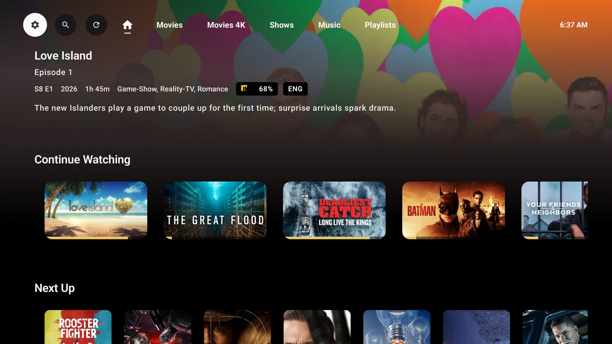
  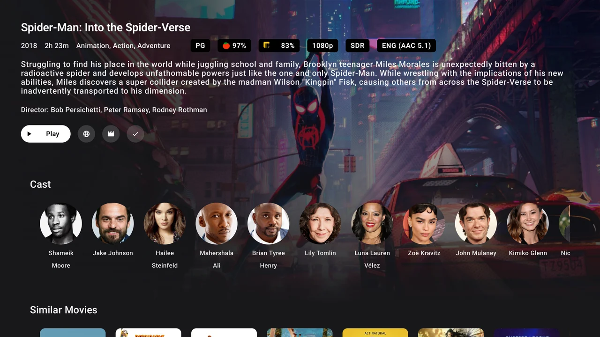
  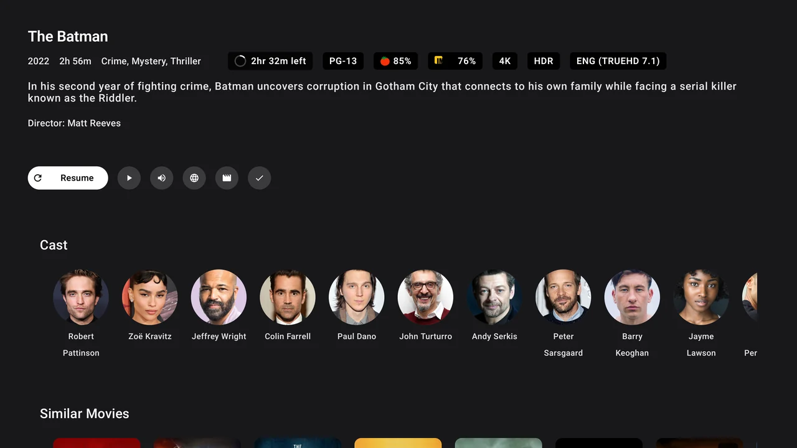
  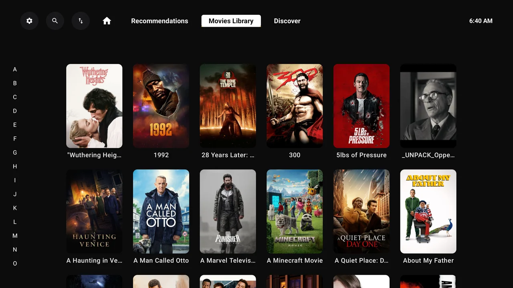
  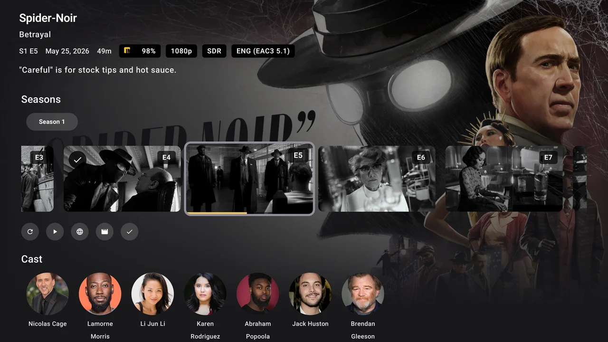
  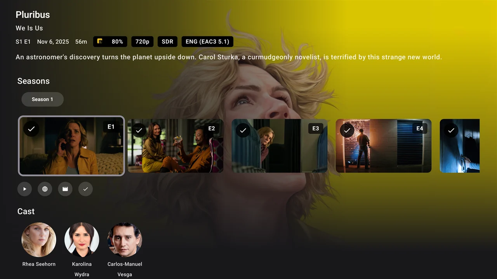
</p>

### Settings tour

<p align="center">
  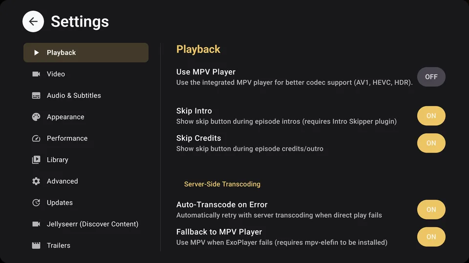
</p>

### Mobile screenshots

<p align="center">
  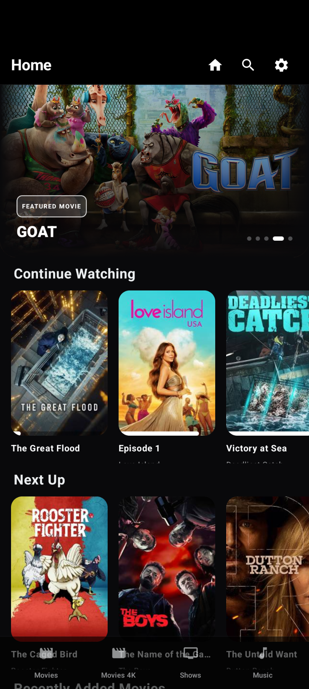
  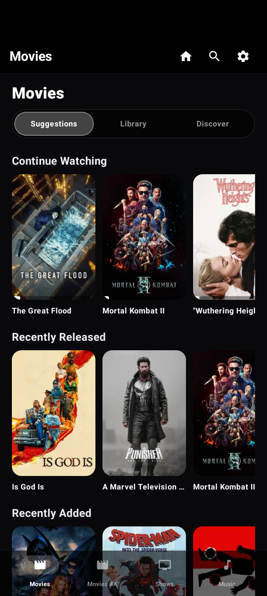
  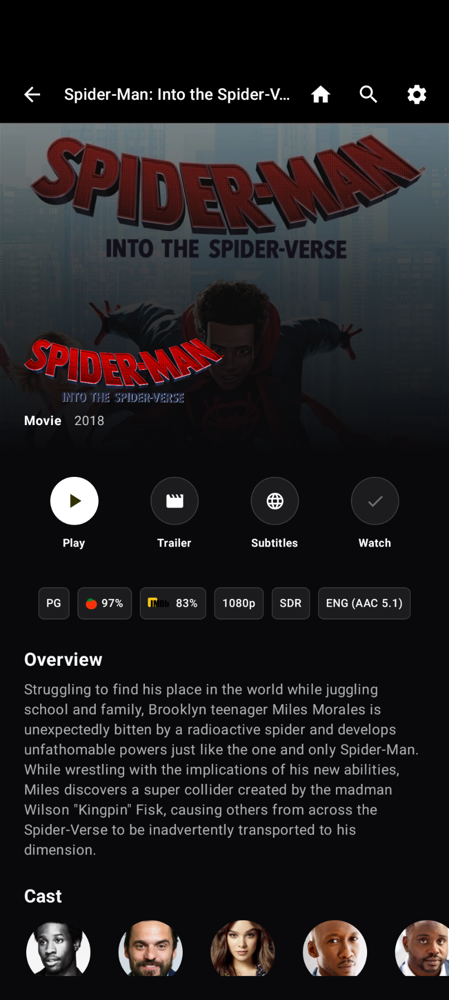
  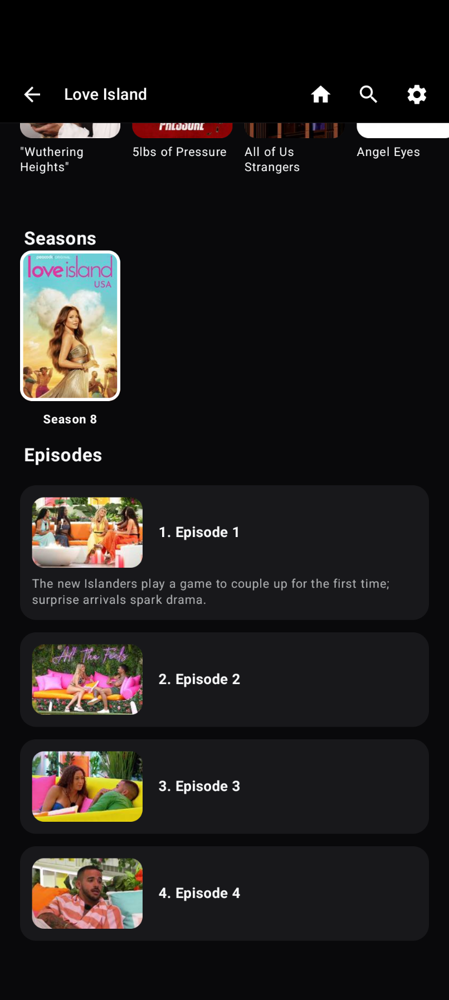
  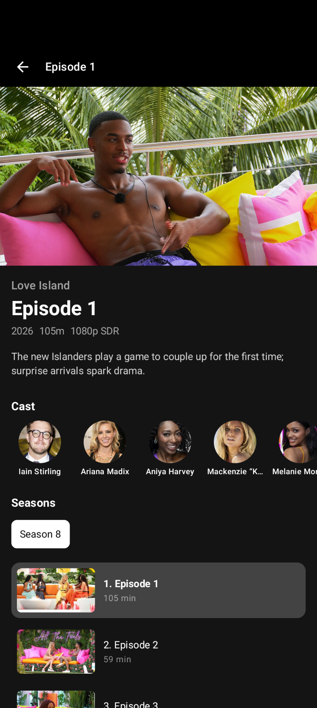
  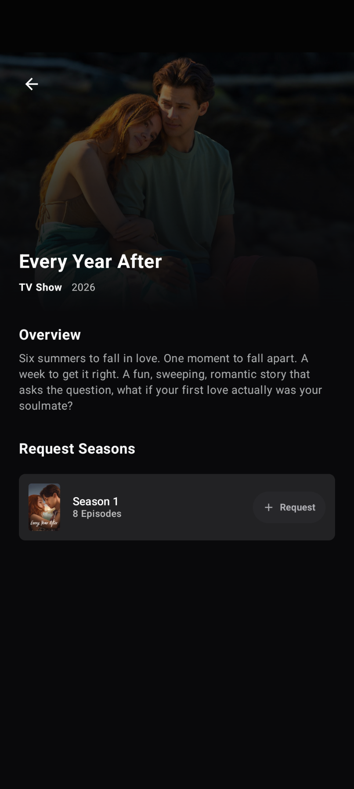
</p>

## Requirements

- **Android TV** device or Android TV emulator
- **Android 5.0 (API 21)** or higher
- **Jellyfin Server** (any version with API support)
- Network connection to Jellyfin server

### Recommended Devices
- ✅ **NVIDIA Shield** (2015/2017/2019/Pro) - Optimized for Tegra X1
- ✅ **Chromecast with Google TV** (4K/HD)
- ✅ **ONN 4K Streaming Box**
- ✅ Budget Android TV boxes - Performance mode available
- ✅ Android TV built into smart TVs

## Configuration

### Server Connection

1. Launch the app on your Android TV
2. Enter your Jellyfin server URL
3. Login with your credentials or use Quick Connect

### Settings

Access settings from the home screen to configure:
- **Player Preferences**: Elefin Cinema (MPV), ExoPlayer (FFmpeg), or the original MPV player
- **Video Enhancements**: Fake HDR, sharpening with strength controls
- **Subtitle Options**: Size, color, background transparency
- **Performance Mode**: Disable animations for weaker devices
- **Image Loading**: Caching, resolution, library preferences
- **Dark Mode**: Pure dark theme without background images
- **Auto-refresh**: Configure new media detection intervals
- **Time Format**: 12/24 hour display
- And more customization options...

## Performance

Elefin is optimized for smooth performance on all Android TV devices:

### Optimization Highlights
- **60fps scrolling** even on older NVIDIA Shield (Tegra X1) hardware
- **@Stable data classes** prevent unnecessary UI recomposition
- **Debounced background loading** reduces server requests by 80-90%
- **Optimized image caching** with memory and disk cache for instant loading
- **1080p backgrounds** (75% smaller than 4K) with hardware acceleration
- **Performance mode** available for budget devices (disables animations, reduces image resolution)
- **LazyRow/LazyColumn optimization** with proper keys and contentType
- **GL pipeline warmup** prevents initial UI stutter

### Based on Industry Best Practices
- Google TV UI optimization techniques
- Netflix/Disney+/Plex-style debounced carousels
- Professional streaming app performance patterns
- Optimized for both high-end and budget Android TV hardware


## Technical Details

### Built With

- **Kotlin** - Programming language
- **Jetpack Compose for TV** - Modern UI framework
- **Material Design 3** - Design system
- **ExoPlayer/Media3** - Video playback engine with full codec support
- **Jellyfin FFmpeg Decoder** - Advanced audio codec support (DTS, TrueHD, AC3, etc.)
- **OpenGL ES 2.0** - Custom video post-processing pipeline (fake HDR, sharpening)
- **MPV** - Playback engine for Elefin Cinema and the original MPV player
- **Ktor** - HTTP client for Jellyfin API
- **Coil/Glide** - Image loading libraries
- **Kotlin Serialization** - JSON parsing

### Architecture

- **MVVM pattern** with Repository pattern for clean separation
- **Jetpack Compose for TV** for declarative, reactive UI
- **Kotlin Coroutines** for asynchronous operations and background tasks
- **StateFlow** for reactive state management
- **@Stable annotations** for optimized recomposition
- **LazyRow/LazyColumn** with proper keys and contentType for efficient scrolling
- **Debounced state updates** for performance optimization
- **Hardware-accelerated rendering** with OpenGL ES 2.0 (optional)

## Contributing

Contributions are welcome! Please feel free to submit a Pull Request.

## License

This project is licensed under the GNU General Public License v3.0 - see the [LICENSE](LICENSE) file for details.

## Acknowledgments

- The Jellyfin team for working hard on delivering an awesome Open Source software
- Built for the [Jellyfin](https://jellyfin.org/) media server
- Uses Material Design components from AndroidX
- Inspired by modern TV streaming interfaces

## Disclaimer

Elefin is an independent client application and is not affiliated with or endorsed by the Jellyfin project.


## Performance testing builds

Use a non-debug build when assessing scrolling on lower-powered TVs. Debug builds can introduce substantial runtime compilation overhead.

The performance variant uses release runtime behavior and the local debug signing key, so it can update an existing debug installation without clearing settings:

```powershell
.\gradlew.bat :app:assemblePerformance
adb -s <device> install --no-incremental -r app/build/outputs/apk/performance/app-performance.apk
adb -s <device> shell cmd package compile -m speed -f com.flex.elefin
```

Restart Elefin after compilation. This variant does not replace release signing for distribution and cannot update an installation signed with a different key. Ahead-of-time compilation above is a device testing step, not a bundled scrolling baseline profile.

Home prepares adjacent off-screen shelves and pauses backdrop dissolves while scrolling. Trickplay previews require server-generated images; subtitle downloads require a configured Jellyfin provider and server support.

## Multiple servers

Open **Settings → Accounts → Add server** to connect another Jellyfin server using a password or Quick Connect. Existing logins remain saved. Adding a server keeps the current server selected; choose **Switch** beside a saved connection to browse it.

One server is active for browsing and playback at a time. Switching rebuilds the navigation stack so old-server details cannot open against the new server. Audio and subtitle track preferences are separated by server and account. **Remove** forgets an inactive saved connection locally; it does not delete the server or its media.

### TV navigation drawer

The side rail is enabled by default when no preference is saved. Toggle **Settings → Appearance → Modal Navigation Drawer** to switch between the rail and the original top bars. Focus the rail to expand it, press OK to choose a destination, and press Right or Back to return to the content. Existing saved preferences are preserved, and changes apply immediately.
